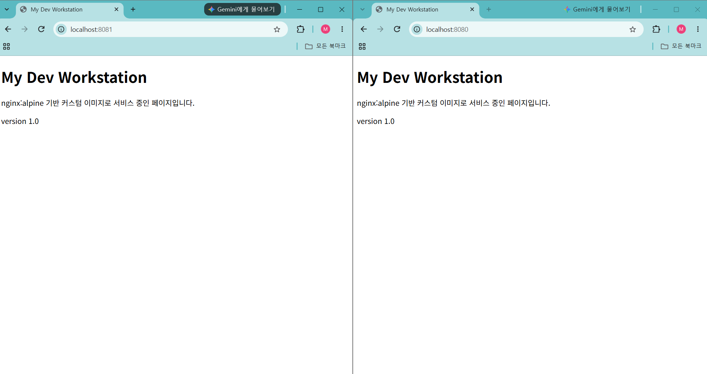
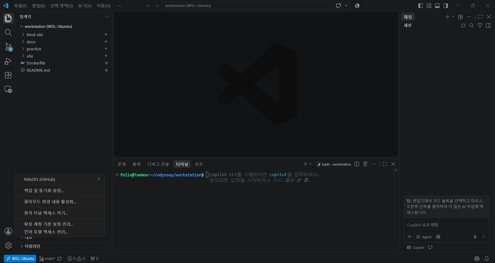
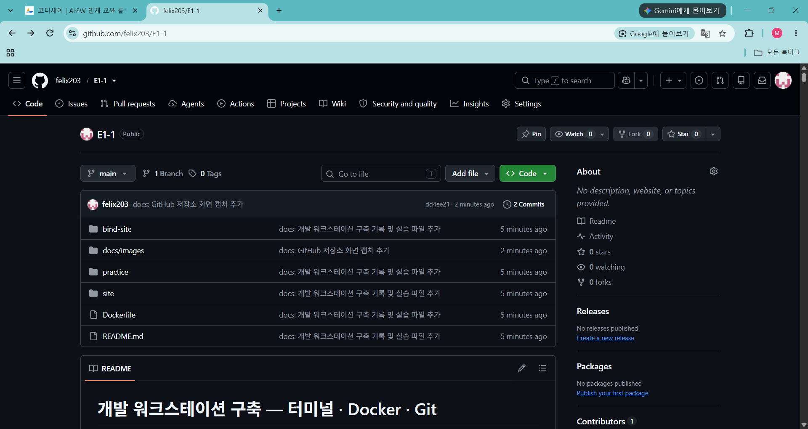

# 개발 워크스테이션 구축 — 터미널 · Docker · Git

> 코디세이 입학연수 미션 「내 컴퓨터에 개발자용 '작업실' 꾸미기」 수행 기록

## 1. 프로젝트 개요

터미널, Docker, Git/GitHub를 직접 세팅해 "내 컴퓨터에서만 돌아가는" 문제가 없는 재현 가능한 개발 환경을 구성한다.

- 터미널로 작업 디렉토리를 구성하고 파일 권한을 관리한다.
- Docker를 설치·점검하고 컨테이너를 실행·관리한다.
- 정적 웹 서버를 Dockerfile로 커스텀 이미지화하고, 포트 매핑으로 접속을 확인한다.
- 바인드 마운트로 "호스트 변경 반영"을, 볼륨으로 "데이터 영속성"을 검증한다.
- Git을 설정하고 VSCode에서 GitHub 저장소와 연동한다.

### 저장소 구조

```
E1-1/
├── README.md            # 기술 문서 (이 문서)
├── Dockerfile           # 커스텀 이미지 정의 (9장)
├── site/index.html      # 이미지에 COPY되는 웹 페이지 (9장)
├── bind-site/index.html # 바인드 마운트 실습용 페이지 (11장)
├── practice/            # 터미널·권한 실습 결과물 (5~6장)
└── docs/images/         # 증거 스크린샷 (10장, 13장)
```

## 2. 실행 환경

| 항목 | 내용 |
|---|---|
| Host OS | Windows 11 (빌드 10.0.26200.9711) |
| WSL | WSL 3.0.5.0 · 커널 6.18.58.1-1 |
| Linux 환경 | WSL2 · Ubuntu 26.04.1 LTS |
| Shell | bash (`/bin/bash`) |
| Terminal | PowerShell 7.6.9에서 `wsl`로 Ubuntu 접속 |
| Docker | 29.9.3 (Docker Desktop, WSL2 backend) |
| Git | 2.53.0 |

```powershell
PS> wsl --version
WSL 버전: 3.0.5.0
커널 버전: 6.18.58.1-1
WSLg 버전: 1.0.79
MSRDC 버전: 1.2.7391
Direct3D 버전: 1.611.1-81528511
DXCore 버전: 10.0.26100.1-240331-1435.ge-release
Windows 버전: 10.0.26200.9711
PS> wsl -l -v
  NAME      STATE           VERSION
* Ubuntu    Stopped         2
```

```bash
$ cat /etc/os-release   # 발췌
PRETTY_NAME="Ubuntu 26.04.1 LTS"
VERSION="26.04.1 LTS (Resolute Raccoon)"
$ echo $SHELL
/bin/bash
$ git --version
git version 2.53.0
```

> **재현 시 주의 (WSL)**
> - 작업 폴더는 Linux 홈(`~`) 아래에 둔다. Windows 드라이브(`/mnt/c/...`)에서는 `chmod` 권한 변경이 반영되지 않는다.
> - PowerShell 7에서는 `wsl ~`가 동작하지 않는다. `wsl`로 접속한 뒤 `cd`로 이동한다. ([트러블슈팅 4](#트러블슈팅-4-powershell-7에서-wsl--실행-실패))
> - Docker Desktop 앱이 실행 중이어야 하고, Settings → Resources → WSL integration에서 Ubuntu가 켜져 있어야 Ubuntu에서 `docker`를 쓸 수 있다. ([트러블슈팅 5](#트러블슈팅-5-docker---version은-되지만-docker-info에서-데몬-연결-실패))

## 3. 수행 체크리스트

- [x] 터미널 기본 조작 및 폴더 구성
- [x] 파일·디렉토리 권한 변경 실습
- [x] Docker 설치 및 데몬 점검
- [x] Docker 기본 운영 명령 (images / ps / logs / stats)
- [x] hello-world · ubuntu 컨테이너 실행, attach / exec 비교
- [x] Dockerfile 커스텀 이미지 빌드·실행
- [x] 포트 매핑 접속 (2개 포트)
- [x] 바인드 마운트 변경 반영
- [x] Docker 볼륨 영속성
- [x] Git 설정 + VSCode GitHub 연동

## 4. 검증 방법

| 항목 | 확인 명령 | 확인한 내용 | 결과 위치 |
|---|---|---|---|
| 터미널 조작 | `pwd`, `ls -la`, `cat` | 생성·복사·이름 변경·이동·삭제 결과가 목록에 반영됨 | [5장](#5-터미널-조작-로그) |
| 권한 | `ls -l`, `ls -ld`, `chmod` | 변경 전/후 권한 문자열, 실행·진입 가능 여부 | [6장](#6-권한-실습) |
| Docker 점검 | `docker --version`, `docker info` | CLI 설치, 데몬 동작 | [7장](#7-docker-설치-및-점검) |
| 운영 명령 | `docker images`, `docker ps -a`, `docker logs`, `docker stats` | 이미지·컨테이너 상태, 로그, 자원 사용량 | [8장](#8-docker-기본-운영-및-컨테이너-실습) |
| 커스텀 이미지 | `docker build`, `docker run` | 빌드 성공, 컨테이너 실행 | [9장](#9-dockerfile-커스텀-이미지) |
| 포트 매핑 | `curl`, 브라우저 | 호스트 포트로 응답 수신 | [10장](#10-포트-매핑) |
| 바인드 마운트 | `curl` (변경 전/후) | 호스트 수정이 재빌드 없이 반영 | [11장](#11-바인드-마운트) |
| 볼륨 | `docker exec ... cat` (삭제 전/후) | 컨테이너 삭제 후 데이터 유지 | [12장](#12-docker-볼륨-영속성) |
| Git/GitHub | `git config --list`, VSCode | 사용자·기본 브랜치 설정, 저장소 연동 | [13장](#13-git-설정-및-github-연동) |

### 빠른 재현 (평가자용)

Docker가 동작하는 환경에서 저장소를 받아 아래 순서로 실행하면 핵심 결과를 확인할 수 있다.

```bash
git clone https://github.com/felix203/E1-1.git
cd E1-1

# 커스텀 이미지 빌드 + 포트 매핑 (9~10장)
docker build -t my-web:1.0 .
docker run -d -p 8080:80 --name my-web-8080 my-web:1.0
curl localhost:8080

# 바인드 마운트 (11장): 저장소 루트에서 실행하면 $(pwd)가 경로를 맞춰 준다
docker run -d -p 8082:80 --name web-bind -v "$(pwd)/bind-site":/usr/share/nginx/html:ro my-web:1.0
curl localhost:8082

# 볼륨 영속성 (12장)
docker volume create web-data
docker run -d --name vol-test -v web-data:/data ubuntu sleep infinity
docker exec vol-test bash -c "echo 'persist test' > /data/hello.txt"
docker rm -f vol-test
docker run -d --name vol-test2 -v web-data:/data ubuntu sleep infinity
docker exec vol-test2 cat /data/hello.txt
```

정리: `docker rm -f my-web-8080 web-bind vol-test2 && docker volume rm web-data`

## 5. 터미널 조작 로그

작업 위치: `~/codyssey/workstation/practice`

### 5-1. 현재 위치 확인 · 작업 폴더 생성

```bash
$ pwd
/mnt/c/Windows/System32
$ mkdir -p ~/codyssey/workstation/practice
$ cd ~/codyssey/workstation/practice
$ pwd
/home/felix/codyssey/workstation/practice
```

Ubuntu가 Windows 경로(`/mnt/c/...`)에서 시작되어, Linux 홈 아래에 작업 폴더를 만들고 이동했다.

### 5-2. 파일 생성 · 목록 확인 (숨김 파일 포함)

```bash
$ touch empty.txt
$ echo "hello cody" > hello.txt
$ touch .hidden_file
$ ls -l
total 4
-rw-r--r-- 1 felix felix  0 Nov 10 15:18 empty.txt
-rw-r--r-- 1 felix felix 11 Nov 10 15:18 hello.txt
$ ls -la
total 12
drwxr-xr-x 2 felix felix 4096 Nov 10 15:19 .
drwxr-xr-x 3 felix felix 4096 Nov 10 15:16 ..
-rw-r--r-- 1 felix felix    0 Nov 10 15:19 .hidden_file
-rw-r--r-- 1 felix felix    0 Nov 10 15:18 empty.txt
-rw-r--r-- 1 felix felix   11 Nov 10 15:18 hello.txt
```

- `touch`로 만든 `empty.txt`는 크기 0(빈 파일), `echo ... >`로 만든 `hello.txt`는 11바이트(10글자 + 줄바꿈).
- `ls -l`에는 없던 `.hidden_file`이 `ls -la`에서 표시된다. 이름이 `.`으로 시작하는 파일은 숨김 파일이다.

### 5-3. 파일 내용 확인

```bash
$ cat hello.txt
hello cody
```

### 5-4. 디렉토리 이동 (절대 경로)

```bash
$ mkdir backup
$ cd ..
$ cd ~/codyssey/workstation/practice/backup
$ pwd
/home/felix/codyssey/workstation/practice/backup
$ cd ..
```

> 경로를 잘못 지정해 실패한 시도는 [트러블슈팅 1](#트러블슈팅-1-절대-경로-지정-오류로-이동-실패) 참고

### 5-5. 복사 · 이름 변경

```bash
$ cp hello.txt backup/hellp_copy.txt
$ mv empty.txt blank.txt
$ ls -la
total 16
drwxr-xr-x 3 felix felix 4096 Nov 10 15:24 .
drwxr-xr-x 3 felix felix 4096 Nov 10 15:16 ..
-rw-r--r-- 1 felix felix    0 Nov 10 15:19 .hidden_file
drwxr-xr-x 2 felix felix 4096 Nov 10 15:24 backup
-rw-r--r-- 1 felix felix    0 Nov 10 15:18 blank.txt
-rw-r--r-- 1 felix felix   11 Nov 10 15:18 hello.txt
$ ls -la backup
total 12
drwxr-xr-x 2 felix felix 4096 Nov 10 15:24 .
drwxr-xr-x 3 felix felix 4096 Nov 10 15:24 ..
-rw-r--r-- 1 felix felix   11 Nov 10 15:24 hellp_copy.txt
```

- `cp`: `hello.txt`와 같은 크기(11바이트)의 복사본이 `backup` 안에 생성됨.
- `mv`: 같은 폴더 안에서 경로를 바꾸면 이름 변경이 된다 (`empty.txt` → `blank.txt`).

### 5-6. 삭제

```bash
$ mkdir trash
$ touch trash/temp.txt
$ rm trash/temp.txt
$ rm backup/hellp_copy.txt
$ ls -la
total 20
drwxr-xr-x 4 felix felix 4096 Nov 10 15:25 .
drwxr-xr-x 3 felix felix 4096 Nov 10 15:16 ..
-rw-r--r-- 1 felix felix    0 Nov 10 15:19 .hidden_file
drwxr-xr-x 2 felix felix 4096 Nov 10 15:27 backup
-rw-r--r-- 1 felix felix    0 Nov 10 15:18 blank.txt
-rw-r--r-- 1 felix felix   11 Nov 10 15:18 hello.txt
drwxr-xr-x 2 felix felix 4096 Nov 10 15:26 trash
$ ls -la backup
total 8
drwxr-xr-x 2 felix felix 4096 Nov 10 15:27 .
drwxr-xr-x 4 felix felix 4096 Nov 10 15:25 ..
```

> `rmdir`로 파일을 지우려다 실패한 시도는 [트러블슈팅 2](#트러블슈팅-2-rmdir로-파일-삭제-실패) 참고

### 5-7. 보충: 상대 경로 이동 · 파일 이동 · 디렉토리 삭제

```bash
$ cd backup
$ pwd
/home/felix/codyssey/workstation/practice/backup
$ cd ..
$ mv blank.txt backup/
$ ls -la
total 20
drwxr-xr-x 4 felix felix 4096 Nov 10 16:21 .
drwxr-xr-x 3 felix felix 4096 Nov 10 15:16 ..
-rw-r--r-- 1 felix felix    0 Nov 10 15:19 .hidden_file
drwxr-xr-x 2 felix felix 4096 Nov 10 16:21 backup
-rw-r--r-- 1 felix felix   11 Nov 10 15:18 hello.txt
drwxr-xr-x 2 felix felix 4096 Nov 10 15:26 trash
$ ls -la backup
total 8
drwxr-xr-x 2 felix felix 4096 Nov 10 16:21 .
drwxr-xr-x 4 felix felix 4096 Nov 10 16:21 ..
-rw-r--r-- 1 felix felix    0 Nov 10 15:18 blank.txt
$ rmdir trash
$ ls -la
total 16
drwxr-xr-x 3 felix felix 4096 Nov 10 16:22 .
drwxr-xr-x 3 felix felix 4096 Nov 10 15:16 ..
-rw-r--r-- 1 felix felix    0 Nov 10 15:19 .hidden_file
drwxr-xr-x 2 felix felix 4096 Nov 10 16:21 backup
-rw-r--r-- 1 felix felix   11 Nov 10 15:18 hello.txt
```

- `cd backup`: 현재 위치(`practice`) 기준 **상대 경로**. 5-4에서 절대 경로로 들어간 것과 같은 폴더에 도착한다.
- `mv blank.txt backup/`: 다른 폴더로 경로를 바꾸면 **이동**이 된다. `blank.txt`가 `practice` 목록에서 사라지고 `backup` 안에 나타났다.
- `rmdir trash`: 5-6에서 안의 `temp.txt`를 먼저 지워 빈 디렉토리가 되었으므로 `rmdir`로 삭제된다.

## 6. 권한 실습

### 6-1. 파일 권한: 실행 권한(x) 추가

```bash
$ printf '#!/bin/bash\necho "run.sh executed"\n' > run.sh
$ ls -l run.sh
-rw-r--r-- 1 felix felix 35 Nov 10 16:23 run.sh
$ ./run.sh
bash: ./run.sh: Permission denied
$ chmod 755 run.sh
$ ls -l run.sh
-rwxr-xr-x 1 felix felix 35 Nov 10 16:23 run.sh
$ ./run.sh
run.sh executed
```

| | 변경 전 | 변경 후 |
|---|---|---|
| 권한 | `-rw-r--r--` (644) | `-rwxr-xr-x` (755) |
| `./run.sh` 실행 | `Permission denied` | 실행 성공 |

- 새로 만든 파일의 기본 권한 644에는 실행(x) 권한이 없어 스크립트 실행이 거부되었다.
- 755 = 소유자 `rwx`(4+2+1=7), 그룹 `r-x`(4+1=5), 기타 `r-x`(5). 모두 실행할 수 있지만 수정은 소유자만 가능하다.

### 6-2. 디렉토리 권한: 진입 권한(x) 제거

```bash
$ ls -ld backup
drwxr-xr-x 2 felix felix 4096 Nov 10 16:21 backup
$ chmod 644 backup
$ ls -ld backup
drw-r--r-- 2 felix felix 4096 Nov 10 16:21 backup
$ cd backup
-bash: cd: backup: Permission denied
$ chmod 755 backup
$ ls -ld backup
drwxr-xr-x 2 felix felix 4096 Nov 10 16:21 backup
$ cd backup
$ pwd
/home/felix/codyssey/workstation/practice/backup
$ cd ..
```

| | 처음 | 변경 | 복구 |
|---|---|---|---|
| 권한 | `drwxr-xr-x` (755) | `drw-r--r--` (644) | `drwxr-xr-x` (755) |
| `cd backup` | 가능 | `Permission denied` | 가능 |

- 디렉토리에서 x는 **진입 권한**이다. 소유자에게 r, w가 있어도 x가 없으면 `cd`로 들어갈 수 없다.
- 디렉토리 자체의 권한은 `ls -ld`로 확인한다. `-d` 없이 `ls -l backup`을 실행하면 디렉토리 안의 내용물이 출력된다.

## 7. Docker 설치 및 점검

Windows에서는 Docker Desktop(WSL2 backend)을 설치해 사용했다. 앱을 실행하면 내부에서 Docker 데몬이 구동되고, WSL integration을 통해 Ubuntu 터미널에서 `docker` 명령을 쓸 수 있다.

```bash
$ docker --version
Docker version 29.9.3, build 5457199
$ docker info   # 발췌
Client:
 Version:    29.9.3
 Context:    default
Server:
 Containers: 0
  Running: 0
  Paused: 0
  Stopped: 0
 Images: 0
 Server Version: 29.9.3
 Storage Driver: overlayfs
 Cgroup Version: 2
 Kernel Version: 6.18.58.1-microsoft-standard-WSL2
 Operating System: Docker Desktop
 OSType: linux
 Architecture: x86_64
 CPUs: 4
 Total Memory: 7.659GiB
 Name: docker-desktop
```

- `docker --version`: 클라이언트(CLI) 29.9.3 설치 확인.
- `docker info`: `Server:` 정보가 출력됨 → 데몬이 실행 중이고 클라이언트와 연결되어 있음을 확인.
- `OSType: linux`, `Kernel Version: ...WSL2`: 데몬은 Docker Desktop이 관리하는 WSL2 리눅스 환경에서 실행된다. 컨테이너는 리눅스 커널을 공유하므로 Windows에서도 리눅스 환경이 필요하다.
- `Containers: 0`, `Images: 0`: 아직 아무것도 실행하지 않은 초기 상태.

> 설치 직후에는 `docker info`가 데몬 연결에 실패했다. → [트러블슈팅 5](#트러블슈팅-5-docker---version은-되지만-docker-info에서-데몬-연결-실패)

## 8. Docker 기본 운영 및 컨테이너 실습

### 8-1. hello-world 실행

실행 전 상태 (이미지·컨테이너 없음):

```bash
$ docker images
                                                        i Info →   U  In Use
IMAGE   ID             DISK USAGE   CONTENT SIZE   EXTRA
$ docker ps
CONTAINER ID   IMAGE     COMMAND   CREATED   STATUS    PORTS     NAMES
$ docker ps -a
CONTAINER ID   IMAGE     COMMAND   CREATED   STATUS    PORTS     NAMES
```

실행 및 결과:

```bash
$ docker run hello-world
Unable to find image 'hello-world:latest' locally
latest: Pulling from library/hello-world
4f55086f7dd0: Pull complete
d5e71e642bf5: Download complete
Digest: sha256:cf1b20a0c89a666b6950fecda7ccbc1b1a86520e7c53f908f3a21e79d0d60458
Status: Downloaded newer image for hello-world:latest

Hello from Docker!
This message shows that your installation appears to be working correctly.

To generate this message, Docker took the following steps:
 1. The Docker client contacted the Docker daemon.
 2. The Docker daemon pulled the "hello-world" image from the Docker Hub.
    (amd64)
 3. The Docker daemon created a new container from that image which runs the
    executable that produces the output you are currently reading.
 4. The Docker daemon streamed that output to the Docker client, which sent it
    to your terminal.
...
$ docker images
                                                        i Info →   U  In Use
IMAGE                ID             DISK USAGE   CONTENT SIZE   EXTRA
hello-world:latest   cf1b20a0c89a       25.9kB         9.49kB    U
$ docker ps
CONTAINER ID   IMAGE     COMMAND   CREATED   STATUS    PORTS     NAMES
$ docker ps -a
CONTAINER ID   IMAGE         COMMAND    CREATED          STATUS                      PORTS     NAMES
0c9d3764b7cf   hello-world   "/hello"   15 seconds ago   Exited (0) 14 seconds ago             nifty_hofstadter
```

- 로컬에 이미지가 없어 Docker Hub에서 pull한 뒤 컨테이너를 생성·실행했다. 출력의 1~4단계가 클라이언트 → 데몬 → 레지스트리 → 컨테이너로 이어지는 Docker 구조를 그대로 보여준다.
- 메시지를 출력한 뒤 메인 프로세스(`/hello`)가 끝나 컨테이너가 바로 종료되었다(`Exited (0)`, 0은 정상 종료). 그래서 `docker ps`(실행 중만)에는 없고 `docker ps -a`(전체)에만 보인다.
- `--name`을 지정하지 않아 `nifty_hofstadter`라는 랜덤 이름이 붙었다.
- `docker images`의 `U`(In Use): 정지된 컨테이너도 이미지를 계속 참조하고 있다.

> 처음에 이미지 이름을 `hellp-world`로 잘못 입력해 `pull access denied ... repository does not exist or may require 'docker login'` 에러가 났다. 메시지에 로그인이 언급되지만 원인은 오타였다. Docker는 존재하지 않는 저장소와 권한이 필요한 비공개 저장소를 같은 메시지로 안내하므로, 이 에러는 이름부터 확인한다.

### 8-2. ubuntu 컨테이너 진입 및 명령 실행

```bash
$ docker run -it --name ubuntu-it ubuntu bash
Unable to find image 'ubuntu:latest' locally
latest: Pulling from library/ubuntu
96aae9022e0e: Pull complete
517b871c26ea: Pull complete
e211d985152c: Download complete
Digest: sha256:065aa8626841f16057b78b027b464cd59c4fac36c204c72dcbf48d66f5fa8a96
Status: Downloaded newer image for ubuntu:latest
root@f079a121ce48:/# ls
bin   dev  home  lib64  mnt  proc  run   srv  tmp  var
boot  etc  lib   media  opt  root  sbin  sys  usr
root@f079a121ce48:/# echo "hello from container"
hello from container
root@f079a121ce48:/# cat /etc/os-release   # 발췌
PRETTY_NAME="Ubuntu 26.04.1 LTS"
VERSION="26.04.1 LTS (Resolute Raccoon)"
root@f079a121ce48:/# uname -r
6.18.58.1-microsoft-standard-WSL2
root@f079a121ce48:/# exit
exit
```

- `-it`: 키보드 입력 유지(`-i`) + 터미널 연결(`-t`)로 컨테이너 안의 bash를 직접 사용했다.
- 프롬프트가 `root@f079a121ce48`로 바뀌었다. 호스트 이름은 컨테이너 ID이고, 사용자는 호스트의 felix가 아니라 컨테이너 안의 root다 → 호스트와 격리된 환경.
- `uname -r` 결과가 호스트의 WSL2 커널과 같다 → 컨테이너는 자체 커널 없이 **호스트 커널을 공유**한다. 반면 `/etc/os-release`는 이미지에 포함된 파일이라 이미지의 버전을 보여준다(이번에는 `ubuntu:latest`가 호스트와 같은 26.04.1).
- `exit`로 메인 프로세스인 bash가 끝나 컨테이너도 종료되었다(`Exited (0)`, 8-3의 `docker ps -a`에서 확인).

### 8-3. attach와 exec 차이 관찰

```bash
$ docker run -dit --name ubuntu-test ubuntu bash
4e41c6639b3cd7c7a53780653461af8dba3016bff5c2e8548af0efddf4dd1fcf
$ docker exec -it ubuntu-test bash
root@4e41c6639b3c:/# "exec session"
bash: exec session: command not found
root@4e41c6639b3c:/# exit
exit
$ docker ps
CONTAINER ID   IMAGE     COMMAND   CREATED          STATUS          PORTS     NAMES
4e41c6639b3c   ubuntu    "bash"    46 seconds ago   Up 46 seconds             ubuntu-test
$ docker attach ubuntu-test
root@4e41c6639b3c:/#
root@4e41c6639b3c:/# ecit
bash: ecit: command not found
root@4e41c6639b3c:/# exit
exit
$ docker ps -a
CONTAINER ID   IMAGE         COMMAND    CREATED              STATUS                       PORTS     NAMES
4e41c6639b3c   ubuntu        "bash"     About a minute ago   Exited (127) 8 seconds ago             ubuntu-test
f079a121ce48   ubuntu        "bash"     6 minutes ago        Exited (0) 5 minutes ago               ubuntu-it
0c9d3764b7cf   hello-world   "/hello"   8 minutes ago        Exited (0) 8 minutes ago               nifty_hofstadter
```

| | 하는 일 | exit 후 컨테이너 |
|---|---|---|
| `docker exec -it ubuntu-test bash` | 컨테이너 안에 **새 bash 프로세스**를 추가로 실행 | `Up` 유지 |
| `docker attach ubuntu-test` | 이미 실행 중인 **메인 프로세스(bash)**에 터미널 연결 | `Exited` 종료 |

- 컨테이너는 메인 프로세스가 살아 있는 동안만 실행된다. exec로 띄운 bash는 부가 프로세스라 종료돼도 컨테이너에 영향이 없고, attach로 연결한 bash는 메인 프로세스라 exit하면 컨테이너가 종료된다.
- attach 상태에서 컨테이너를 종료하지 않고 빠져나오려면 `Ctrl+P` → `Ctrl+Q`(detach)를 쓴다.
- `-dit`: 백그라운드(`-d`)로 실행하되 입력·터미널(`-it`)을 유지해, 메인 bash가 바로 끝나지 않게 한다.
- 입력 실수 해석: exec 세션의 `"exec session"`은 `echo` 없이 문자열만 입력해 명령으로 해석되었다. `Exited (127)`은 Docker 오류가 아니라, 인자 없는 `exit`가 직전 명령(`ecit`, command not found → 종료 코드 127)의 종료 코드를 그대로 반환했기 때문이다. 정상 종료한 `ubuntu-it`는 `Exited (0)`이다.

### 8-4. 운영 명령: logs · stats · stop · start

```bash
$ docker run -d --name web-test nginx:alpine
Unable to find image 'nginx:alpine' locally
alpine: Pulling from library/nginx
...
Status: Downloaded newer image for nginx:alpine
40b52bef97c48b9b974bd81e8764abf3b98bdf34ce37ba3193504a5c67c57d61
$ docker logs web-test   # 발췌
/docker-entrypoint.sh: Configuration complete; ready for start up
2026/11/12 02:19:14 [notice] 1#1: nginx/1.31.8
2026/11/12 02:19:14 [notice] 1#1: OS: Linux 6.18.58.1-microsoft-standard-WSL2
2026/11/12 02:19:14 [notice] 1#1: start worker processes
2026/11/12 02:19:14 [notice] 1#1: start worker process 29
2026/11/12 02:19:14 [notice] 1#1: start worker process 30
2026/11/12 02:19:14 [notice] 1#1: start worker process 31
2026/11/12 02:19:14 [notice] 1#1: start worker process 32
$ docker stop web-test
web-test
$ docker images
                                                        i Info →   U  In Use
IMAGE                ID             DISK USAGE   CONTENT SIZE   EXTRA
hello-world:latest   cf1b20a0c89a       25.9kB         9.49kB    U
nginx:alpine         713fc2ebfd92       94.5MB         27.3MB    U
ubuntu:latest        065aa8626841        163MB         45.9MB    U
$ docker start web-test
web-test
$ docker ps
CONTAINER ID   IMAGE          COMMAND                  CREATED         STATUS         PORTS     NAMES
40b52bef97c4   nginx:alpine   "/docker-entrypoint.…"   2 minutes ago   Up 2 seconds   80/tcp    web-test
$ docker stats --no-stream
CONTAINER ID   NAME       CPU %     MEM USAGE / LIMIT     MEM %     NET I/O         BLOCK I/O     PIDS
40b52bef97c4   web-test   0.00%     6.645MiB / 7.659GiB   0.08%     1.17kB / 126B   9.99MB / 0B   5
$ docker stop web-test
web-test
$ docker ps -a
CONTAINER ID   IMAGE          COMMAND                  CREATED          STATUS                       PORTS     NAMES
40b52bef97c4   nginx:alpine   "/docker-entrypoint.…"   3 minutes ago    Exited (0) 8 seconds ago               web-test
4e41c6639b3c   ubuntu         "bash"                   7 minutes ago    Exited (127) 5 minutes ago             ubuntu-test
f079a121ce48   ubuntu         "bash"                   11 minutes ago   Exited (0) 11 minutes ago              ubuntu-it
0c9d3764b7cf   hello-world    "/hello"                 13 minutes ago   Exited (0) 13 minutes ago              nifty_hofstadter
```

> 발췌 로그다. `docker`를 빼고 입력해 실패한 `stats`, `stop` 명령과 중간의 `docker ps -a`는 생략했다.

- `docker logs`: 메인 프로세스(nginx)의 출력이 기록된다. 워커 프로세스 4개(29~32)의 시작 기록과 함께, `OS: Linux ...WSL2`로 커널 공유가 한 번 더 확인된다.
- `docker stats --no-stream`: 실행 중인 컨테이너의 CPU·메모리·네트워크·디스크 I/O·프로세스 수를 한 번만 출력한다. 메모리 한도 7.659GiB는 `docker info`의 Total Memory와 같고, PIDS 5는 nginx 마스터 1개 + 워커 4개와 일치한다.
- `docker stop` → `Exited (0)`: 종료 신호를 받아 정상 종료되었다.
- `docker start`: 새 컨테이너를 만드는 것이 아니라 정지된 기존 컨테이너를 다시 실행한다. 컨테이너 ID(`40b52bef97c4`)와 CREATED 시각이 그대로다 → **정지는 삭제가 아니다.**
- `PORTS 80/tcp`: nginx가 컨테이너 안의 80번에서 대기 중이지만 호스트와 연결되지 않은 상태다. → [10장](#10-포트-매핑)에서 `-p`로 연결한다.
- `docker images`: 컨테이너 4개가 모두 정지 상태여도 각자의 이미지를 참조하므로 이미지 3개가 전부 `U`(In Use)다.

## 9. Dockerfile 커스텀 이미지

### 9-1. 베이스 이미지 선택

**방식 (A) 웹 서버 베이스 이미지 + 정적 콘텐츠 교체**를 선택했다.

- 베이스: `nginx:alpine` (공식 nginx 이미지의 Alpine Linux 버전)
- 선택 이유: 웹 서버 설치와 실행 명령(CMD)이 이미 구성되어 있어, 콘텐츠와 설정만 덧붙이면 된다. Alpine 기반이라 이미지가 가볍다.
- 베이스 이미지의 CMD(nginx 실행)를 그대로 물려받으므로 Dockerfile에 CMD를 따로 쓰지 않았다.

### 9-2. 소스 파일

```
workstation/
├── Dockerfile
└── site/
    └── index.html
```

`Dockerfile`

```dockerfile
FROM nginx:alpine
LABEL org.opencontainers.image.title="workstation-web" \
      org.opencontainers.image.description="Codyssey workstation custom nginx"
ENV APP_ENV=dev
COPY site/ /usr/share/nginx/html/
EXPOSE 80
HEALTHCHECK --interval=30s --timeout=3s CMD wget -q --spider http://localhost/ || exit 1
```

`site/index.html`

```html
<!doctype html>
<html lang="ko">
<head>
  <meta charset="utf-8">
  <title>My Dev Workstation</title>
</head>
<body>
  <h1>My Dev Workstation</h1>
  <p>nginx:alpine 기반 커스텀 이미지로 서비스 중인 페이지입니다.</p>
  <p>version 1.0</p>
</body>
</html>
```

### 9-3. 커스텀 포인트와 목적

| 커스텀 포인트 | 목적 |
|---|---|
| `LABEL` (title, description) | 이미지 이름·설명을 메타데이터로 기록해 식별하기 쉽게 한다 |
| `ENV APP_ENV=dev` | 실행 환경 값을 코드 수정 없이 컨테이너에 주입한다 (설정과 코드의 분리) |
| `COPY site/ /usr/share/nginx/html/` | nginx 기본 페이지를 직접 만든 페이지로 교체한다 |
| `EXPOSE 80` | 이 이미지가 80번 포트를 사용한다는 것을 문서화한다 (실제 연결은 `-p`) |
| `HEALTHCHECK` | 30초마다 웹 서버가 실제로 응답하는지 자동 점검해 컨테이너 상태에 표시한다 |

### 9-4. 빌드

```bash
$ docker build -t my-web:1.0 .
[+] Building 1.2s (7/7) FINISHED                             docker:default
 => [internal] load build definition from Dockerfile                   0.0s
 => => transferring dockerfile: 342B                                   0.0s
 => [internal] load metadata for docker.io/library/nginx:alpine        0.1s
 => [internal] load .dockerignore                                      0.0s
 => [internal] load build context                                      0.0s
 => => transferring context: 344B                                      0.0s
 => [1/2] FROM docker.io/library/nginx:alpine@sha256:713fc2ebfd92e821  0.7s
 ...
 => [2/2] COPY site/ /usr/share/nginx/html/                            0.1s
 => exporting to image                                                 0.2s
 ...
 => => naming to docker.io/library/my-web:1.0                          0.0s
$ docker images
                                                        i Info →   U  In Use
IMAGE                ID             DISK USAGE   CONTENT SIZE   EXTRA
hello-world:latest   cf1b20a0c89a       25.9kB         9.49kB    U
my-web:1.0           03e730c3b534       93.7MB         26.4MB
nginx:alpine         713fc2ebfd92       94.5MB         27.3MB    U
ubuntu:latest        065aa8626841        163MB         45.9MB    U
```

- `-t my-web:1.0`: 이미지에 `이름:태그`를 붙인다.
- 맨 끝 `.`은 **빌드 컨텍스트**(현재 폴더)다. `transferring context: 344B`는 이 폴더의 파일(`site/` 등)이 데몬으로 전달된 것이고, `COPY site/`도 이 폴더를 기준으로 찾는다.
- 빌드 단계는 `[1/2] FROM`, `[2/2] COPY` 두 개뿐이다. 파일 시스템을 바꾸는 명령만 레이어가 되고, `LABEL`·`ENV`·`EXPOSE`·`HEALTHCHECK`는 이미지 설정(메타데이터)으로 기록된다.
- `nginx:alpine`은 8-4에서 이미 받아 두었으므로 다시 pull하지 않고 로컬 이미지를 사용했다.

### 9-5. 실행 및 커스텀 포인트 확인

```bash
$ docker run -d -p 8080:80 --name my-web-8080 my-web:1.0
2d85db7cc80b92bf39314b4371586176de07bb19b330f4235696223695a9919c
$ docker ps
CONTAINER ID   IMAGE        COMMAND                  CREATED          STATUS                             PORTS                                     NAMES
2d85db7cc80b   my-web:1.0   "/docker-entrypoint.…"   10 seconds ago   Up 10 seconds (health: starting)   0.0.0.0:8080->80/tcp, [::]:8080->80/tcp   my-web-8080
$ curl localhost:8080
<!doctype html>
<html lang="ko">
<head>
  <meta charset="utf-8">
  <title>My Dev Workstation</title>
</head>
<body>
  <h1>My Dev Workstation</h1>
  <p>nginx:alpine 기반 커스텀 이미지로 서비스 중인 페이지입니다.</p>
  <p>version 1.0</p>
</body>
</html>
$ docker exec my-web-8080 env | grep APP_ENV
APP_ENV=dev
$ docker inspect --format '{{json .Config.Labels}}' my-web:1.0
{"maintainer":"NGINX Docker Maintainers <docker-maint@nginx.com>","org.opencontainers.image.description":"Codyssey workstation custom nginx","org.opencontainers.image.title":"workstation-web"}
$ docker ps
CONTAINER ID   IMAGE        COMMAND                  CREATED              STATUS                        PORTS                                     NAMES
2d85db7cc80b   my-web:1.0   "/docker-entrypoint.…"   About a minute ago   Up About a minute (healthy)   0.0.0.0:8080->80/tcp, [::]:8080->80/tcp   my-web-8080
```

| 커스텀 포인트 | 확인 방법 | 결과 |
|---|---|---|
| `COPY` | `curl localhost:8080` | 기본 nginx 페이지가 아닌 직접 만든 `index.html` 응답 |
| `ENV` | `docker exec ... env` | `APP_ENV=dev` |
| `LABEL` | `docker inspect` | 직접 지정한 title, description 표시 |
| `HEALTHCHECK` | `docker ps` STATUS | `health: starting` → 약 30초 후 `healthy` |

- `docker inspect`의 Labels에는 내가 지정한 두 값 외에 `maintainer`도 있다. 베이스 이미지 `nginx:alpine`에 있던 값을 그대로 물려받은 것으로, 기존 이미지 위에 레이어와 설정을 **덧붙이는** 구조임을 보여준다.

## 10. 포트 매핑

### 10-1. 같은 이미지로 두 포트에 실행

실행 명령 (8080은 [9-5](#9-5-실행-및-커스텀-포인트-확인)에서 실행):

```bash
docker run -d -p 8080:80 --name my-web-8080 my-web:1.0
docker run -d -p 8081:80 --name my-web-8081 my-web:1.0
```

확인:

```bash
$ docker ps
CONTAINER ID   IMAGE        COMMAND                  CREATED          STATUS                    PORTS                                     NAMES
db14df753484   my-web:1.0   "/docker-entrypoint.…"   12 minutes ago   Up 12 minutes (healthy)   0.0.0.0:8081->80/tcp, [::]:8081->80/tcp   my-web-8081
2d85db7cc80b   my-web:1.0   "/docker-entrypoint.…"   2 hours ago      Up 2 hours (healthy)      0.0.0.0:8080->80/tcp, [::]:8080->80/tcp   my-web-8080
$ docker port my-web-8080
80/tcp -> 0.0.0.0:8080
80/tcp -> [::]:8080
$ docker port my-web-8081
80/tcp -> 0.0.0.0:8081
80/tcp -> [::]:8081
$ curl localhost:8081
<!doctype html>
<html lang="ko">
<head>
  <meta charset="utf-8">
  <title>My Dev Workstation</title>
</head>
<body>
  <h1>My Dev Workstation</h1>
  <p>nginx:alpine 기반 커스텀 이미지로 서비스 중인 페이지입니다.</p>
  <p>version 1.0</p>
</body>
</html>
$ docker logs --tail 3 my-web-8081
::1 - - [12/Nov/2026:04:02:58 +0000] "GET / HTTP/1.1" 200 272 "-" "Wget" "-"
::1 - - [12/Nov/2026:04:03:28 +0000] "GET / HTTP/1.1" 200 272 "-" "Wget" "-"
172.17.0.1 - - [12/Nov/2026:04:03:33 +0000] "GET / HTTP/1.1" 200 272 "-" "curl/8.18.0" "-"
```

### 10-2. 브라우저 접속 증거

Windows 브라우저에서 `http://localhost:8080`, `http://localhost:8081`에 각각 접속한 화면 (주소창 포함):



### 10-3. 해석

- **이미지 1개 → 컨테이너 2개**: 같은 `my-web:1.0`으로 두 컨테이너를 실행했다. 컨테이너 포트는 둘 다 80이지만 컨테이너마다 네트워크가 분리되어 있어 충돌하지 않는다. 호스트는 하나이므로 **호스트 포트(8080, 8081)는 반드시 달라야 한다.**
- **포트 매핑이 필요한 이유**: 컨테이너는 호스트와 격리된 별도 네트워크에서 실행된다. [8-4](#8-4-운영-명령-logs--stats--stop--start)의 `web-test`는 `PORTS`가 `80/tcp`뿐이라 바깥에서 접속할 수 없었다. `-p 호스트포트:컨테이너포트`로 호스트 포트에 들어온 요청을 컨테이너 포트로 전달해야 접속할 수 있다.
- **`docker port`**: IPv4(`0.0.0.0`)와 IPv6(`[::]`)의 모든 주소에 연결되어 있다. 특정 주소로 제한하려면 `-p 127.0.0.1:8080:80`처럼 지정한다.
- **`docker logs`의 출발지 주소**: `curl` 요청은 `172.17.0.1`(Docker 기본 브리지 네트워크의 게이트웨이)에서 온 것으로 기록되었다. 호스트의 요청이 Docker 네트워크를 거쳐 전달된다는 것을 보여준다. 30초 간격의 `::1 ... "Wget"` 요청은 HEALTHCHECK가 컨테이너 안에서 보낸 점검 요청이다.
- Docker Desktop이 포트를 Windows 쪽으로도 전달하므로, WSL이 아닌 Windows 브라우저에서도 `localhost`로 접속된다.

## 11. 바인드 마운트

이미지 소스(`site/`)와 분리하기 위해 실습용 폴더 `bind-site/`를 따로 만들어 nginx의 웹 루트에 연결했다.

### 11-1. 호스트 폴더 준비

```bash
$ mkdir -p bind-site
$ echo "<h1>Bind mount - before</h1>" > bind-site/index.html
$ cat bind-site/index.html
<h1>Bind mount - before</h1>
```

### 11-2. 바인드 마운트로 실행 (변경 전)

```bash
$ docker run -d -p 8082:80 --name web-bind -v "$(pwd)/bind-site":/usr/share/nginx/html:ro my-web:1.0
fc0c2e0bfb6c8413967d9baf59abc17e7326786e9cbabe7882afa0ca4c5644f7
$ docker ps   # 발췌
CONTAINER ID   IMAGE        COMMAND                  CREATED          STATUS                            PORTS                                     NAMES
fc0c2e0bfb6c   my-web:1.0   "/docker-entrypoint.…"   5 seconds ago    Up 5 seconds (health: starting)   0.0.0.0:8082->80/tcp, [::]:8082->80/tcp   web-bind
$ curl localhost:8082
<h1>Bind mount - before</h1>
```

### 11-3. 호스트에서 파일 수정 (변경 후)

```bash
$ echo "<h1>Bind mount - after (edited on host)</h1>" > bind-site/index.html
$ curl localhost:8082
<h1>Bind mount - after (edited on host)</h1>
$ docker exec web-bind cat /usr/share/nginx/html/index.html
<h1>Bind mount - after (edited on host)</h1>
```

| | 호스트 `bind-site/index.html` | `curl localhost:8082` 응답 |
|---|---|---|
| 변경 전 | `Bind mount - before` | `Bind mount - before` |
| 변경 후 (호스트에서 수정) | `Bind mount - after (edited on host)` | `Bind mount - after (edited on host)` |

### 11-4. 해석

- **`-v "$(pwd)/bind-site":/usr/share/nginx/html:ro`**: `-v 호스트경로:컨테이너경로` 형식이다. 앞부분이 `/`로 시작하는 경로이므로 바인드 마운트로 해석된다(이름만 쓰면 볼륨). `$(pwd)`는 현재 폴더의 절대 경로로 바뀌므로, 다른 PC에서도 저장소 루트에서 실행하면 경로가 자동으로 맞춰진다. `:ro`는 컨테이너가 호스트 파일을 수정하지 못하게 하는 읽기 전용 옵션이다.
- **즉시 반영**: 재빌드도, 컨테이너 재시작도 없이 호스트에서 수정한 내용이 바로 응답에 반영되었다. `docker exec`로 컨테이너 안의 파일을 읽어도 수정된 내용이 나온다. 복사본이 아니라 **호스트의 같은 파일을 컨테이너가 직접 보고 있기** 때문이다.
- **이미지 내용을 가림**: `my-web:1.0` 이미지 안에는 `version 1.0` 페이지가 들어 있지만, 응답은 마운트한 폴더의 내용이었다. 마운트한 폴더가 이미지의 원래 디렉토리를 덮어 가린다.
- **`COPY`와 비교**: [9장](#9-dockerfile-커스텀-이미지)의 `COPY`는 빌드 시점에 파일을 이미지에 복사하므로, 내용을 바꾸려면 재빌드하고 컨테이너를 다시 만들어야 한다. 바인드 마운트는 개발 중 자주 수정하는 파일을 실시간으로 반영할 때 적합하다.

## 12. Docker 볼륨 영속성

### 12-1. 볼륨 생성

```bash
$ docker volume create web-data
web-data
$ docker volume ls
DRIVER    VOLUME NAME
local     web-data
```

### 12-2. 볼륨을 연결한 컨테이너에 데이터 쓰기 (삭제 전)

```bash
$ docker run -d --name vol-test -v web-data:/data ubuntu sleep infinity
80cce0169a0f82c1ad9c5bb7da2be6459ccca08f9ef16d571fa49991e1e8f3da
$ docker exec vol-test bash -c "echo 'persist test' > /data/hello.txt && cat /data/hello.txt"
persist test
```

### 12-3. 컨테이너 삭제 후 새 컨테이너에서 확인 (삭제 후)

```bash
$ docker rm -f vol-test
vol-test
$ docker ps -a
CONTAINER ID   IMAGE          COMMAND                  CREATED          STATUS                     PORTS                                     NAMES
fc0c2e0bfb6c   my-web:1.0     "/docker-entrypoint.…"   10 minutes ago   Up 10 minutes (healthy)    0.0.0.0:8082->80/tcp, [::]:8082->80/tcp   web-bind
db14df753484   my-web:1.0     "/docker-entrypoint.…"   40 minutes ago   Up 40 minutes (healthy)    0.0.0.0:8081->80/tcp, [::]:8081->80/tcp   my-web-8081
2d85db7cc80b   my-web:1.0     "/docker-entrypoint.…"   2 hours ago      Up 2 hours (healthy)       0.0.0.0:8080->80/tcp, [::]:8080->80/tcp   my-web-8080
40b52bef97c4   nginx:alpine   "/docker-entrypoint.…"   2 hours ago      Exited (0) 2 hours ago                                               web-test
4e41c6639b3c   ubuntu         "bash"                   2 hours ago      Exited (127) 2 hours ago                                             ubuntu-test
f079a121ce48   ubuntu         "bash"                   2 hours ago      Exited (0) 2 hours ago                                               ubuntu-it
0c9d3764b7cf   hello-world    "/hello"                 2 hours ago      Exited (0) 2 hours ago                                               nifty_hofstadter
$ docker run -d --name vol-test2 -v web-data:/data ubuntu sleep infinity
01f4ce56c798b18bf599cf4abaa53165fd508dd5fb5613fc1f3aeeccc1726166
$ docker exec vol-test2 cat /data/hello.txt
persist test
$ docker volume inspect web-data
[
    {
        "CreatedAt": "2026-11-12T04:30:27Z",
        "Driver": "local",
        "Labels": null,
        "Mountpoint": "/var/lib/docker/volumes/web-data/_data",
        "Name": "web-data",
        "Options": null,
        "Scope": "local"
    }
]
```

`docker ps -a` 목록에서 `vol-test`가 완전히 사라졌지만, 같은 볼륨을 연결한 새 컨테이너 `vol-test2`에서 데이터가 그대로 읽혔다.

### 12-4. 대조 실험: 볼륨 없이 같은 작업

```bash
$ docker run -d --name no-vol ubuntu sleep infinity
c3f6d60acc7a5ae91f4a8e78175a840d0f188cdcb51dd3fc4cb0c320b674255f
$ docker exec no-vol bash -c "echo 'no volume' > /tmp/test.txt && cat /tmp/test.txt"
no volume
$ docker rm -f no-vol
no-vol
$ docker run -d --name no-vol2 ubuntu sleep infinity
adddf63ab9e1f71a63bf0e61d2f1dc39b86ff1c3a0211520d48e9939922447a5
$ docker exec no-vol2 cat /tmp/test.txt
cat: /tmp/test.txt: No such file or directory
```

| | 볼륨 사용 (`web-data:/data`) | 볼륨 없음 (`/tmp`) |
|---|---|---|
| 컨테이너 삭제 전 | `persist test` | `no volume` |
| 삭제 후 새 컨테이너 | `persist test` → **유지** | `No such file or directory` → **소멸** |

### 12-5. 해석

- **볼륨이 없을 때**: 컨테이너 안에서 만든 파일은 그 컨테이너 전용 쓰기 레이어에 저장된다. `docker rm`으로 컨테이너를 삭제하면 쓰기 레이어도 함께 사라지고, 새 컨테이너는 원본 이미지에서 다시 시작하므로 파일이 없다.
- **볼륨이 있을 때**: 데이터가 컨테이너 바깥의 Docker 관리 영역(`Mountpoint`)에 저장된다. 컨테이너를 삭제해도 볼륨은 남으며, `docker volume rm`으로 직접 지워야 삭제된다. Docker Desktop 환경에서 이 경로는 Docker 엔진이 실행되는 내부 리눅스 환경에 있으므로, Ubuntu에서 직접 접근하지 않고 Docker 명령으로 관리한다.
- **`-v web-data:/data`**: 앞부분이 경로가 아닌 **이름**이므로 볼륨으로 해석된다([11장](#11-바인드-마운트)의 경로 지정과 비교).

| | 바인드 마운트 (11장) | 볼륨 (12장) |
|---|---|---|
| 지정 방법 | 호스트 경로 (`$(pwd)/bind-site`) | 볼륨 이름 (`web-data`) |
| 관리 주체 | 사용자 (내 폴더) | Docker |
| 주 용도 | 개발 중 파일 실시간 반영 | DB 등 오래 보존할 데이터 |
| 컨테이너 삭제 시 | 호스트 폴더 그대로 | 볼륨 그대로 (`docker volume rm`으로 삭제) |

## 13. Git 설정 및 GitHub 연동

### 13-1. Git 사용자 정보 · 기본 브랜치 설정

```bash
$ git config --global user.name "felix203"
$ git config --global user.email "102566250+felix203@users.noreply.github.com"
$ git config --global init.defaultBranch main
```

- `user.name`, `user.email`: 모든 커밋에 기록되는 **작성자 정보(이름표)**다. 인증 수단이 아니며, push 권한은 GitHub 로그인으로 따로 확인한다.
- 이메일은 개인 주소 대신 GitHub의 **noreply 주소**를 사용했다. Public 저장소의 커밋 기록에 개인 이메일이 남지 않게 하기 위해서다([15장](#15-보안-점검)).
- `init.defaultBranch main`: 새 저장소의 기본 브랜치 이름이다. Git 기본값(`master`) 대신 GitHub과 같은 `main`을 쓰도록, `git init`보다 **먼저** 설정했다.

### 13-2. 로컬 저장소 생성 및 원격 저장소 연결

```bash
$ cd ~/codyssey/workstation
$ git init
Initialized empty Git repository in /home/felix/codyssey/workstation/.git/
$ git status
On branch main

No commits yet

Untracked files:
  (use "git add <file>..." to include in what will be committed)
        Dockerfile
        bind-site/
        docs/
        practice/
        site/

nothing added to commit but untracked files present (use "git add" to track)
$ git remote add origin https://github.com/felix203/E1-1.git
$ git remote -v
origin  https://github.com/felix203/E1-1.git (fetch)
origin  https://github.com/felix203/E1-1.git (push)
$ git config --list
user.name=felix203
user.email=102566250+felix203@users.noreply.github.com
init.defaultbranch=main
core.repositoryformatversion=0
core.filemode=true
core.bare=false
core.logallrefupdates=true
remote.origin.url=https://github.com/felix203/E1-1.git
remote.origin.fetch=+refs/heads/*:refs/remotes/origin/*
```

- `git init` 후 `On branch main`: 기본 브랜치 설정이 적용되었다. `.git` 숨김 폴더가 로컬 저장소의 실체다.
- `git config --list`의 앞 세 줄은 `--global` 설정(`~/.gitconfig`), `core.*`와 `remote.origin.*`은 이 저장소에만 적용되는 설정(`.git/config`)이다.
- `origin`: 원격 저장소(GitHub의 `E1-1`)에 붙인 별칭이다.

### 13-3. VSCode GitHub 연동

VSCode의 WSL 확장으로 Ubuntu의 저장소 폴더를 열고, GitHub 계정으로 로그인했다.



- 창 제목과 왼쪽 아래 상태 표시줄의 `WSL: Ubuntu`: VSCode가 Ubuntu 환경에 연결되어 Ubuntu의 Git과 설정을 사용한다.
- 상태 표시줄의 `main`: 현재 브랜치.
- 계정 메뉴의 `felix203 (GitHub)`: GitHub 로그인 완료. push 시 이 인증이 사용된다.
- 내장 터미널이 Ubuntu bash(`felix@TaeWoo:~/codyssey/workstation$`)로 열린다.

> 처음에는 VSCode가 WSL이 아닌 Windows 모드로 열렸다. → [트러블슈팅 7](#트러블슈팅-7-vscode가-wsl이-아닌-windows-모드로-열림)

### 13-4. GitHub 저장소 반영 결과

VSCode의 소스 제어 화면에서 커밋하고 `origin`(E1-1)으로 push했다.



### 13-5. Git과 GitHub의 역할

| | Git | GitHub |
|---|---|---|
| 정체 | 버전 관리 **도구** | Git 저장소를 호스팅하는 원격 협업 **플랫폼** |
| 위치 | 내 컴퓨터 (`.git`) | 인터넷 서버 (`github.com/felix203/E1-1`) |
| 이 과제에서 한 일 | 사용자 설정, `init`, 커밋으로 변경 이력 기록 | 원격 저장소 보관, 제출용 공개, VSCode 로그인 인증 |

`git init`과 커밋은 인터넷 없이 내 컴퓨터에서 동작하고, GitHub과 통신하는 것은 push·pull 단계다.

## 14. 트러블슈팅

### 트러블슈팅 1: 절대 경로 지정 오류로 이동 실패

- **문제**: `~/codyssey/workstation`에서 `practice/backup`으로 이동하려고 `cd /practice/backup`, `cd ~/practice/backup`을 실행했으나 둘 다 `No such file or directory` 발생.
- **원인 가설**: `/`로 시작하는 경로는 현재 위치와 무관하게 루트(`/`)부터 찾는 절대 경로다. `~`도 홈 디렉토리(`/home/felix`)로 확장되는 절대 경로라서, 실제 위치(`~/codyssey/workstation/practice/backup`)와 다른 곳을 가리켰을 것이다.
- **확인**: 두 번째 에러 메시지에 쉘이 확장한 실제 경로 `/home/felix/practice/backup`이 표시됨 → 홈 바로 아래에서 `practice`를 찾고 있었다.
- **해결**: 전체 절대 경로 `~/codyssey/workstation/practice/backup`으로 이동 성공. 현재 위치 기준 상대 경로 `practice/backup`도 가능하다.

```bash
$ cd /practice/backup
bash: cd: /practice/backup: No such file or directory
$ cd ~/practice/backup
bash: cd: /home/felix/practice/backup: No such file or directory
$ cd ~/codyssey/workstation/practice/backup
$ pwd
/home/felix/codyssey/workstation/practice/backup
```

### 트러블슈팅 2: `rmdir`로 파일 삭제 실패

- **문제**: `backup` 안의 복사본을 지우려고 `rmdir`을 실행했으나 두 번 모두 실패.
- **원인 가설**: ① 파일명을 잘못 입력했다. ② `rmdir`은 빈 디렉토리 전용 명령이라 파일에는 쓸 수 없다.
- **확인**: 첫 시도는 `No such file or directory` → `ls -la backup`으로 본 실제 파일명은 `hellp_copy.txt`였다. 이름을 고친 두 번째 시도는 `Not a directory` → 대상이 디렉토리가 아닌 일반 파일(권한 문자열 첫 글자 `-`)이라 거부됨.
- **해결**: 파일은 `rm`으로 삭제. 빈 디렉토리는 `rmdir`, 내용이 있는 디렉토리는 `rm -r`을 쓴다.

```bash
$ rmdir backup/hello_cody.txt
rmdir: failed to remove 'backup/hello_cody.txt': No such file or directory
$ rmdir backup/hellp_copy.txt
rmdir: failed to remove 'backup/hellp_copy.txt': Not a directory
$ rm backup/hellp_copy.txt
$ ls -la backup
total 8
drwxr-xr-x 2 felix felix 4096 Nov 10 15:27 .
drwxr-xr-x 4 felix felix 4096 Nov 10 15:25 ..
```

### 트러블슈팅 3: Ubuntu에서 `wsl` 명령을 찾지 못함

- **문제**: 실행 환경 기록을 위해 Ubuntu 터미널에서 `wsl --version`을 실행했으나 `wsl: command not found` 발생.
- **원인 가설**: `wsl`은 WSL을 관리하는 Windows 프로그램(`wsl.exe`)이다. 리눅스 쉘은 Windows처럼 `.exe` 확장자를 자동으로 붙여 찾지 않으므로, `wsl`이라는 이름의 명령을 찾지 못했을 것이다.
- **확인**: 같은 명령을 PowerShell에서 실행하자 정상 출력됨([2장](#2-실행-환경)) → Windows 쪽에서 실행해야 하는 명령임을 확인.
- **해결**: Windows 명령은 PowerShell에서 실행한다. WSL 안에서는 `wsl.exe --version`처럼 확장자까지 붙여 Windows 프로그램을 호출할 수도 있다.

```bash
$ wsl --version
wsl: command not found
```

### 트러블슈팅 4: PowerShell 7에서 `wsl ~` 실행 실패

- **문제**: Ubuntu를 리눅스 홈에서 바로 시작하려고 PowerShell에서 `wsl ~`를 실행했으나 `C:Usersfelix: command not found` 발생.
- **원인 가설**: PowerShell 7이 `~`를 Windows 홈 경로(`C:\Users\felix`)로 먼저 바꿔서 wsl에 넘겼고, wsl은 이것을 "실행할 명령"으로 bash에 전달했다. bash는 `\`를 이스케이프 문자로 처리해 지웠으므로 `C:Usersfelix`라는 명령을 찾게 됐을 것이다.
- **확인**: 에러 메시지의 명령 이름 `C:Usersfelix`는 `C:\Users\felix`에서 `\`만 빠진 형태다. 즉 `~`가 리눅스 홈이 아니라 Windows 홈으로 바뀌어 전달되었다.
- **해결/대안**: `wsl`로 접속한 뒤 `cd ~/codyssey/workstation/practice`로 이동했다. 따옴표로 감싸 PowerShell이 `~`를 바꾸지 못하게 하는 `wsl '~'`도 대안이다. <!-- wsl '~' 시도 결과 추가 -->

```powershell
PS C:\Windows\System32> wsl ~
/bin/bash: line 1: C:Usersfelix: command not found
PS C:\Windows\System32> wsl
felix@TaeWoo:/mnt/c/Windows/System32$ cd ~/codyssey/workstation/practice
felix@TaeWoo:~/codyssey/workstation/practice$
```

### 트러블슈팅 5: `docker --version`은 되지만 `docker info`에서 데몬 연결 실패

- **문제**: Docker Desktop 설치 후 Ubuntu에서 `docker --version`은 정상 출력되었으나, `docker info`의 `Server:` 항목에서 에러가 발생했다.
- **원인 가설**: Docker는 요청을 보내는 클라이언트(CLI)와 실제 작업을 수행하는 데몬으로 분리되어 있다. 클라이언트는 동작하지만, Ubuntu 배포판이 Docker Desktop의 데몬과 연결(WSL integration)되어 있지 않아 서버 정보를 받지 못했을 것이다.
- **확인**: 에러 메시지가 WSL integration 활성화를 권고했다. 또한 `Client:`의 Context가 `desktop-linux`, 플러그인 경로가 Windows 경로(`C:\Program Files\Docker\cli-plugins\...`)로 표시되어, Ubuntu에 연결된 Docker CLI가 아니라 Windows 쪽 클라이언트가 응답하고 있었다.
- **해결**: Docker Desktop → Settings → Resources → WSL integration에서 Ubuntu 통합을 켜고 Apply & restart. 이후 Context가 `default`, 플러그인 경로가 `/usr/local/lib/docker/cli-plugins/...`로 바뀌고 `Server:` 정보가 정상 출력되었다.

```bash
# 해결 전 (발췌)
$ docker --version
Docker version 29.9.3, build 5457199
$ docker info
Client:
 Version:    29.9.3
 Context:    desktop-linux
  buildx: Docker Buildx (Docker Inc.)
    Path:     C:\Program Files\Docker\cli-plugins\docker-buildx.exe
Server:
ERROR: Error response from daemon: The command 'docker' could not be found in this WSL 2 distro.
We recommend to activate the WSL integration in Docker Desktop settings.

# 해결 후 (발췌)
$ docker info
Client:
 Version:    29.9.3
 Context:    default
  buildx: Docker Buildx (Docker Inc.)
    Path:     /usr/local/lib/docker/cli-plugins/docker-buildx
Server:
 Containers: 0
 Images: 0
 Server Version: 29.9.3
```

### 트러블슈팅 6: 한글 폴더 이름이 코드(`$'\354...'`)로 표시됨

- **문제**: 스크린샷을 저장소로 복사하려고 `ls /mnt/c/Users/felix/OneDrive/`를 실행하자, 한글 폴더 이름이 `''$'\354\202\254\354\247\204'`처럼 8진수 코드로 표시되었다.
- **원인 가설 1**: 로케일이 UTF-8이 아니어서 `ls`가 한글을 표시할 수 없는 문자로 처리했다.
  - **확인**: `locale` 결과 `LANG=C.UTF-8`로 이미 UTF-8이었다 → **가설 1 기각**.
- **원인 가설 2**: 파일 이름은 정상이고, `ls`가 결과를 터미널 화면에 직접 출력할 때 적용하는 이스케이프(표시) 방식의 문제다. 파이프로 넘기면 원래 이름이 그대로 출력될 것이다.
  - **확인**: `ls ... | cat`으로 출력하자 `사진`, `스크린샷` 등 한글이 정상 표시되었다. `ls --version` 결과 Ubuntu 26.04의 기본 `ls`는 GNU 버전이 아니라 Rust로 재작성된 **uutils coreutils 0.8.0**이었고, 이 환경에서는 UTF-8 로케일에서도 터미널 출력 시 한글을 코드로 표시했다 → **가설 2 확인**.
- **해결/대안**: 파일 이름 자체는 정상이므로 한글 경로를 그대로 지정해 작업했다(`ls .../사진/` 정상 동작). 목록을 읽을 때는 `| cat`을 붙인다. 표시된 코드는 UTF-8 바이트를 8진수로 적은 것으로, `\354\202\254\354\247\204` = "사진"이다. GNU 버전으로 교체하는 방법(`coreutils-from-gnu` 패키지)도 있으나 시스템 기본 도구를 바꾸는 일이라 적용하지 않았다.

```bash
$ ls /mnt/c/Users/felix/OneDrive/   # 발췌
 desktop.ini
 ''$'\353\254\270\354\204\234'
 ''$'\354\202\254\354\247\204'
$ locale   # 발췌
LANG=C.UTF-8
LC_CTYPE="C.UTF-8"
LC_ALL=
$ ls /mnt/c/Users/felix/OneDrive/사진/ | cat   # 발췌
desktop.ini
비디오 프로젝트
스크린샷
카메라 앨범
$ ls --version | head -n 1
ls (uutils coreutils) 0.8.0
```

### 트러블슈팅 7: VSCode가 WSL이 아닌 Windows 모드로 열림

- **문제**: VSCode에서 저장소 폴더를 열었으나, 내장 터미널이 PowerShell(`pwsh`)이고 경로가 `\\wsl.localhost\Ubuntu\home\felix\codyssey\workstation`으로 표시되었다. 왼쪽 아래에 WSL 연결 표시가 없었다.
- **원인 가설**: WSL 연결 없이 열려, Windows의 VSCode가 Ubuntu 폴더를 네트워크 경로(`\\wsl.localhost`)로 접근하고 있다. 이 상태로 커밋하면 Ubuntu가 아닌 Windows 쪽 Git과 Windows 쪽 Git 설정이 사용되어, Ubuntu에 설정한 작성자 정보(noreply 이메일)가 적용되지 않을 수 있다.
- **확인**: 터미널 종류(`pwsh`), 경로 형식(`\\wsl.localhost\...`), 원격 연결 표시가 없는 상태 표시줄로 Windows 모드임을 확인했다.
- **해결**: WSL 확장을 설치하고 WSL 모드로 폴더를 다시 열었다. 창 제목과 상태 표시줄에 `WSL: Ubuntu`가 표시되고, 터미널이 Ubuntu bash로 바뀌었다([13-3](#13-3-vscode-github-연동) 스크린샷).

## 15. 보안 점검

- [x] **인증 정보 비노출**: Ubuntu 계정 비밀번호는 입력 시 화면에 표시되지 않았다. GitHub 인증은 VSCode에서 브라우저 로그인으로 처리되어 토큰이 터미널·문서에 남지 않는다.
- [x] **커밋 이메일 비공개**: GitHub의 "Keep my email addresses private"를 켜고, 첫 커밋 전에 `user.email`을 noreply 주소로 설정했다.
- [ ] (선택) GitHub "Block command line pushes that expose my email" 활성화: 개인 이메일이 담긴 커밋의 push를 GitHub이 차단한다.
- [ ] **커밋 대상 파일 점검**: README, Dockerfile, 정적 HTML, 실습 파일, 스크린샷만 포함되며 비밀 정보가 없다.
- [ ] **스크린샷 점검**: 다른 탭, 계정 정보, 알림 등 불필요한 개인 정보가 보이지 않는다.

> 민감정보가 커밋된 경우 파일을 지우는 새 커밋만으로는 이력에 남는다. 해당 토큰·비밀번호를 즉시 폐기하고 재발급한 뒤, 이력에서 제거한다.

## 16. 과제 목표 정리

- **절대 경로 vs 상대 경로**: 절대 경로는 루트(`/`)부터 시작하는 전체 경로라 현재 위치와 관계없이 같은 대상을 가리키고, 상대 경로는 현재 위치를 기준으로 한다. 같은 폴더에 `cd ~/codyssey/workstation/practice/backup`(절대)과 `cd backup`(상대)으로 각각 이동했다. → [5-4](#5-4-디렉토리-이동-절대-경로), [5-7](#5-7-보충-상대-경로-이동--파일-이동--디렉토리-삭제), [트러블슈팅 1](#트러블슈팅-1-절대-경로-지정-오류로-이동-실패)
- **파일 권한 r/w/x, 755/644**: 소유자·그룹·기타 각각에 대해 읽기(r=4), 쓰기(w=2), 실행(x=1)의 합을 숫자로 쓴다. 755 = `rwxr-xr-x`, 644 = `rw-r--r--`. 파일의 x는 실행, 디렉토리의 x는 진입 권한이다. → [6장](#6-권한-실습)
- **기존 Dockerfile 기반 커스텀 이미지**: `FROM nginx:alpine`으로 기존 이미지를 물려받고 `COPY`·`ENV`·`LABEL`·`HEALTHCHECK`를 덧붙여 `my-web:1.0`을 만들었다. → [9장](#9-dockerfile-커스텀-이미지)
- **포트 매핑이 필요한 이유**: 컨테이너는 호스트와 격리된 네트워크에서 실행되므로, `-p 호스트포트:컨테이너포트`로 호스트 포트에 들어온 요청을 컨테이너로 전달해야 접속할 수 있다. 같은 내부 포트(80)를 쓰는 컨테이너도 호스트 포트를 달리해 여러 개 실행할 수 있다. → [10장](#10-포트-매핑)
- **Docker 볼륨**: Docker가 관리하는 컨테이너 외부 저장 공간으로, 컨테이너 쓰기 레이어와 분리되어 컨테이너를 삭제해도 데이터가 유지된다. → [12장](#12-docker-볼륨-영속성)
- **Git vs GitHub**: Git은 내 컴퓨터에서 변경 이력을 관리하는 버전 관리 도구, GitHub은 Git 저장소를 호스팅하고 협업 기능을 제공하는 원격 플랫폼이다. → [13-5](#13-5-git과-github의-역할)
